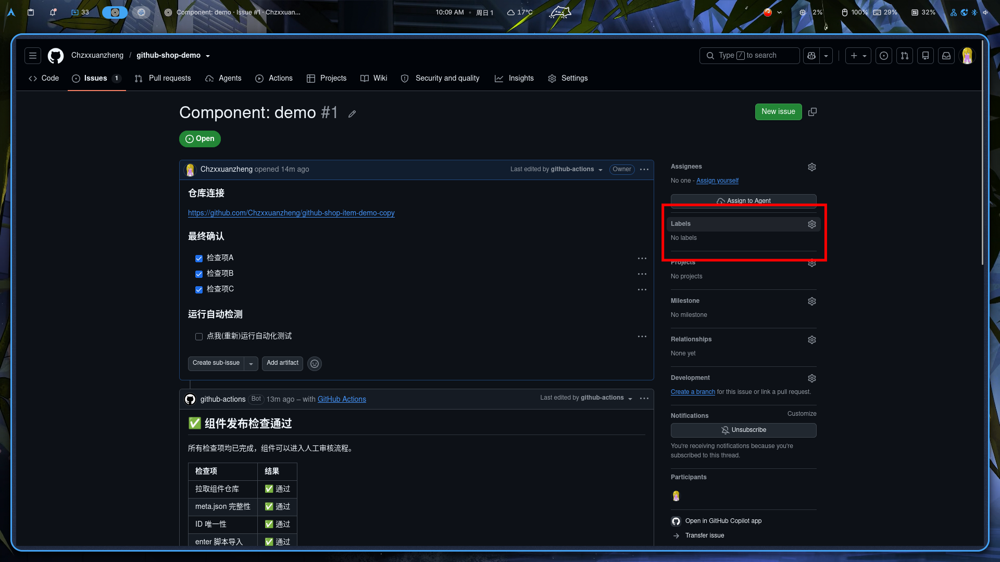

```
./.github/
├── ISSUE_TEMPLATE					# issue提交模板
│   └── comp_publish.yml			# 发布组件的Issue模板
├── scripts							# 跑ci用的脚本
│   ├── check_publish.py			# ai写的检查脚本，往gh发就是掉几个API，问ai就行了
│   └── approve_publish.py			# 审核通过后把组件元信息写进 items.json 并推送
└── workflows						# ci流程
    ├── comp_publish_check.yml		# 校验流程：issue 新建/编辑时跑
    └── comp_publish_approve.yml	# 收录流程：issue 被打上「审核通过」标签时跑
```

除了`check_publish.py`之外我都写得有注释，或者这个地方不需要写注释，你照着看就行了。
`check_publish.py`我相信你的`Python`水平

## 尝试使用

克隆下面的仓库，创建Issue`发布插件`，照着填就行。

```
https://github.com/Chzxxuanzheng/github-shop-item-demo
```

该仓库会有两处报错，一处是`id`重复，修改`meta.json`即可解决。

另外一处是`src/main.py`使用中文冒号。

## 如何审核



创建一个叫做`审核通过`的tag并添加上就视为`审核通过`并进行收录。
如果你不喜欢这个tag，也可以去`comp_publish_approve.yml`自行修改成你喜欢的。